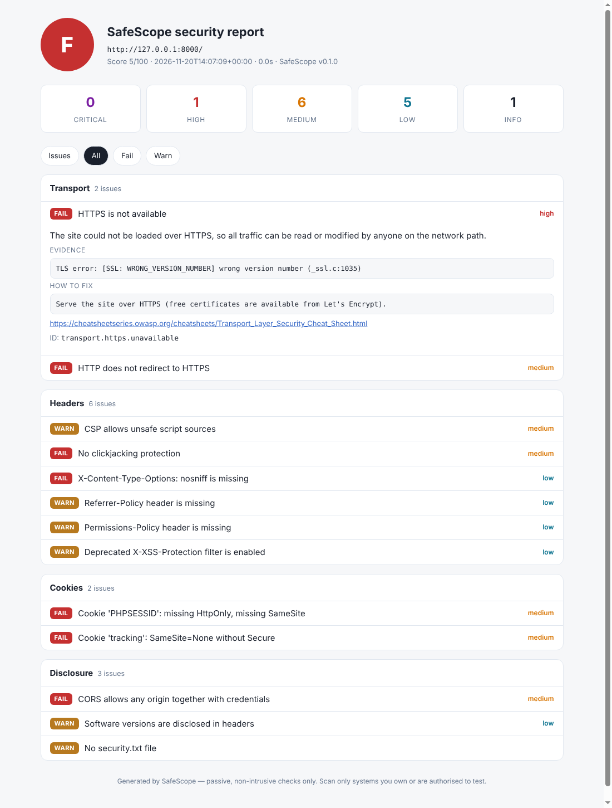
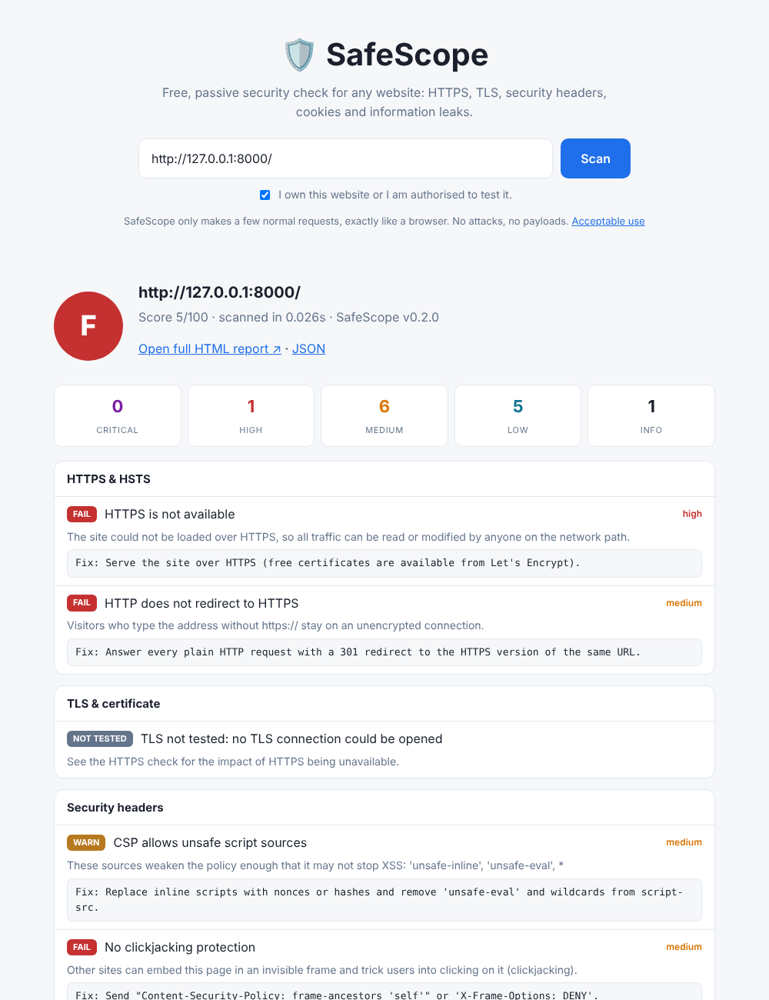

<div align="center">

# 🛡️ SafeScope

**A safe, non-intrusive web security posture scanner.**

Check HTTPS, TLS certificates, security headers, cookies and information leaks in seconds —
from your terminal, your CI pipeline, or Python code. Zero dependencies.

[](https://github.com/Karim-Bazooka/SafeScope/actions/workflows/ci.yml)


[](LICENSE)

**🌐 Try it live: [safescope-one.vercel.app](https://safescope-one.vercel.app)**

[Quick start](#-quick-start) · [Web app](#-web-app) · [Checks](#-what-it-checks) · [CI usage](#-use-it-in-ci) · [Contributing](CONTRIBUTING.md) · [العربية](docs/README.ar.md)



</div>

---

## Why SafeScope?

Most small teams and solo developers ship websites without ever checking the basics: is HTTP
redirected? Is HSTS on? Are session cookies `HttpOnly`? Is the server leaking `PHP/7.4.3`?

SafeScope answers those questions with **passive checks only** — it makes a handful of normal
`GET` requests and one TLS handshake, exactly like a browser would. No fuzzing, no payloads, no
exploitation. That makes it safe to run against production and easy to put in CI.

- **Actionable** — every finding says *why it matters* and *how to fix it*, with references.
- **Graded** — a 0–100 score and an A+ → F grade you can track over time ([how it's computed](docs/scoring.md)).
- **Four output formats** — colourful console, JSON, Markdown (for PR comments / job summaries) and a self-contained HTML report.
- **CI-ready** — `--fail-on medium` turns it into a quality gate.
- **Web app included** — deploy your own scanner page to Vercel in one click, hardened against SSRF abuse.
- **Zero dependencies** — pure Python standard library, installs in a second.
- **Easy to extend** — a check is one small class; see [Writing a check](docs/writing-checks.md).

## 🚀 Quick start

```bash
pip install git+https://github.com/Karim-Bazooka/SafeScope.git

safescope scan example.com
```

Output against the bundled demo server (trimmed):

```text
SafeScope v0.1.0
Target : http://127.0.0.1:8000/
Grade  :  F   score 5/100  (0.0s)

TRANSPORT
  FAIL HTTPS is not available [high]
       ↳ Serve the site over HTTPS (free certificates are available from
         Let's Encrypt).
HEADERS
  WARN CSP allows unsafe script sources [medium]
       · default-src * 'unsafe-inline' 'unsafe-eval'
       ↳ Replace inline scripts with nonces or hashes and remove
         'unsafe-eval' and wildcards from script-src.
COOKIES
  FAIL Cookie 'PHPSESSID': missing HttpOnly, missing SameSite [medium]
       ↳ Set-Cookie: PHPSESSID=...; Secure; HttpOnly; SameSite=Lax
  ...
Issues : 0 critical  1 high  6 medium  5 low  1 info
```

More examples:

```bash
safescope scan https://example.com -f html -o report.html   # shareable HTML report
safescope scan example.com -f json > report.json              # machine readable
safescope scan example.com --only headers,cookies             # run a subset
safescope checks                                              # list all checks
safescope scan example.com --public-only                      # refuse internal/private targets
```

### Try it safely on your own machine

The repo ships a deliberately misconfigured local server so you can see every finding without
touching anyone else's site:

```bash
python examples/vulnerable_demo_server.py            # http://127.0.0.1:8000
safescope scan http://127.0.0.1:8000 --skip tls
python examples/vulnerable_demo_server.py --fixed    # ...and the secure version
```

See [`examples/sample-report.html`](examples/sample-report.html) and
[`examples/sample-report.json`](examples/sample-report.json) for the generated output.

## 🌐 Web app

SafeScope ships with a small web UI and JSON API. A public instance runs at
**<https://safescope-one.vercel.app>** (it scores A+ when it scans itself).

```bash
safescope serve            # http://127.0.0.1:8000
```

[](https://vercel.com/new/clone?repository-url=https%3A%2F%2Fgithub.com%2FKarim-Bazooka%2FSafeScope)

Or deploy it yourself; see [docs/deploy.md](docs/deploy.md). The API:

```text
GET /api/scan?target=example.com              → JSON result
GET /api/scan?target=example.com&format=html  → full HTML report
GET /api/health                               → {"status": "ok"}
```

Because the web version accepts URLs from anyone, it is hardened:

- **SSRF protection** — every connection (including each redirect hop and the TLS handshake) is
  refused if the host resolves to a private, loopback, link-local or cloud-metadata address,
  or uses a port other than 80/443/8080/8443.
- **Rate limiting** — 10 scans per minute per client IP.
- **Strict security headers** — the UI scores A+ with SafeScope itself (CSP without
  `unsafe-inline` scripts, no `innerHTML` anywhere).



## 🔍 What it checks

| Check | ID | Looks at |
|---|---|---|
| HTTPS & HSTS | `transport` | HTTPS availability, HTTP→HTTPS redirect, HTTPS→HTTP downgrade, HSTS presence, `max-age`, `includeSubDomains` |
| TLS & certificate | `tls` | Trusted chain & host name, expiry (warns at 30 days), negotiated protocol, whether TLS 1.0/1.1 are still accepted |
| Security headers | `headers` | `Content-Security-Policy` (incl. `unsafe-inline`/`unsafe-eval`/wildcards), clickjacking protection, `X-Content-Type-Options`, `Referrer-Policy`, `Permissions-Policy`, deprecated `X-XSS-Protection` |
| Cookie security | `cookies` | `Secure`, `HttpOnly` (for session-like cookies), `SameSite`, `SameSite=None` without `Secure` |
| Information disclosure | `disclosure` | Version banners (`Server`, `X-Powered-By`, …), CORS `*` with credentials, `/.well-known/security.txt` |

Every finding has a stable ID (e.g. `headers.csp.missing`) so you can track it across scans.

## ⚙️ Use it in CI

SafeScope exits with code **1** when it finds an issue at or above `--fail-on`:

```yaml
# .github/workflows/security.yml
name: Security posture
on:
  schedule: [{ cron: "0 6 * * 1" }]   # every Monday
  workflow_dispatch:
jobs:
  safescope:
    runs-on: ubuntu-latest
    steps:
      - uses: Karim-Bazooka/SafeScope@v0.1.0
        with:
          target: https://staging.example.com
          fail-on: medium
```

The action also writes a Markdown summary to the job page and uploads the HTML report as an artifact.

| Exit code | Meaning |
|---|---|
| `0` | Scan finished, nothing at/above `--fail-on` |
| `1` | Findings at/above `--fail-on` |
| `2` | Usage error (bad URL, unknown check…) |
| `3` | Target unreachable |

## 🐍 Use it from Python

```python
from safescope import scan

result = scan("example.com")
print(result.grade, result.score)
for finding in result.problems:
    print(finding.severity.label, finding.id, finding.recommendation)
```

## 🗺️ Roadmap

- [x] **v0.1** – HTTPS/HSTS, TLS, headers, cookies, disclosure · console/JSON/Markdown/HTML reports · CI action · web app
- [ ] **v0.2** – Scan many targets from a file, concurrent scanning, SARIF output for GitHub code scanning
- [ ] **v0.3** – Config file (`safescope.toml`) to ignore accepted findings, baseline comparison between scans
- [ ] **v0.4** – More checks: mixed content, subresource integrity, DNS (CAA, DNSSEC), email security (SPF/DMARC)
- [ ] **v1.0** – Dashboard to track the grade of several sites over time

Ideas and votes are welcome in [Issues](https://github.com/Karim-Bazooka/SafeScope/issues).

## 🤝 Contributing

New checks, bug reports and docs improvements are very welcome — the codebase is small and
fully typed. Start with [CONTRIBUTING.md](CONTRIBUTING.md) and look for issues labelled
`good first issue`.

## ⚖️ Responsible use

SafeScope only performs requests a normal browser would make, but **only scan systems you own
or have explicit permission to test.** To report a vulnerability in SafeScope itself, see
[SECURITY.md](SECURITY.md).

## License

[MIT](LICENSE) © 2026 Karim
